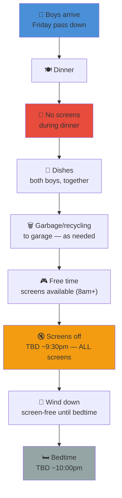

# 01 — Friday

*When boys arrive — evening with Aaron and Denise*

## Schedule

## Rules

| Rule | Detail |
|------|--------|
| Screens available | 8:00am (current rule, not changing) |
| Friday pass down | Level-set conversation when they arrive. How was your week? What's coming up? |
| Garbage/recycling | Bins to garage — done as needed (alternates daily). Part of the floor, not a screen gate. |
| Dishes | After dinner, both boys, together |
| Dinner | No screens during dinner |
| Screens off | TBD ~9:30pm — ALL screens, no exceptions |
| Bedtime | TBD ~10:00pm (same as Saturday) |

> Friday is the arrival day. Evening rules are the same as Saturday. The pass down happens first — level-set, listen, then the evening schedule applies.
