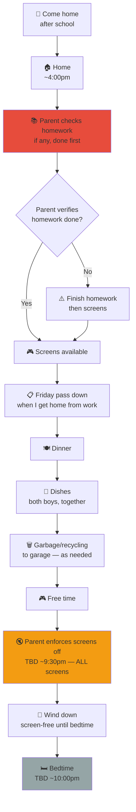
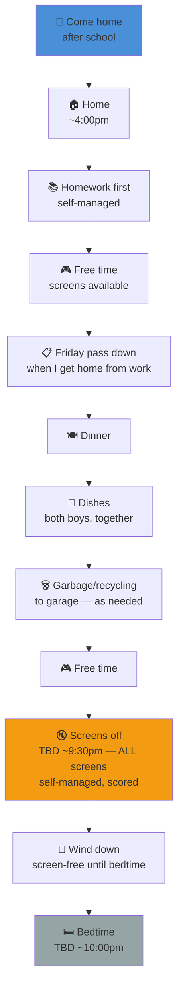

# 01 — Friday

*When boys arrive — evening with Aaron and Denise*
*Every other week they are with us Friday morning. That's just a regular school day — see [04 — School Day](04-school-day.md). The other week they come home to us after school. The Friday evening is the same either way.*

---

## Two Phases

**Phase 1 — Baseline (Nov 13-20):** Parent checks homework before screens. Parent enforces all transitions. No autonomy yet.

**Phase 2 — Trial (Nov 27+):** Boys self-manage homework and transitions. Parent steers on failure. Pass down stays parent-led.

---

## Phase 1 — Baseline Schedule (Week B: pick up after school)

**Phase 1 — what's different:** Parent checks homework before screens open. Parent enforces screens-off and bedtime transitions. No self-management.

---

## Phase 2 — Trial Schedule (Week B: pick up after school)

**Phase 2 — what's different:** Boys self-manage homework before screens — no parent pre-check. If parent finds screens on with homework undone, redirect and log Yellow/Red. Screens-off and bedtime are self-managed transitions, scored on tracker.

---

## Evening Rules (both phases)

| Rule | Detail |
|------|--------|
| Friday pass down | Level-set conversation when Aaron gets home from work. How was your week? What's coming up? |
| Garbage/recycling | Bins to garage — done as needed (alternates daily). Part of the floor, not a screen gate. |
| Dishes | After dinner, both boys, together |
| Screens off | TBD ~9:30pm — ALL screens, no exceptions |
| Bedtime | TBD ~10:00pm (same as Saturday) |

## Friday Pass Down (when Aaron gets home from work — both phases)

When Aaron gets home from work on Friday:
- Level-set conversation with the boys. How was your week? How are you feeling? What's on your mind?
- Inform them: here's what's coming up this week, here's how we're doing.
- Space for them to share. Listen first.

---

> Friday is the arrival day. Every other week, Friday morning is a regular school day (see 04-school-day.md). The other week they come home to us after school. Either way, the pass down happens when Aaron gets home from work, then the evening schedule applies (same as Saturday). Garbage is part of the floor — it gets done, but not a screen gate. The pass down is a parent-led conversation in both phases.
