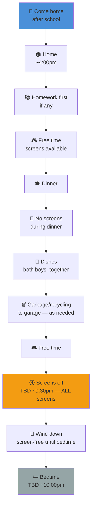

# 01 — Friday

*When boys arrive — evening with Aaron and Denise*
*Every other week they are with us Friday morning. That's just a regular school day — see [04 — School Day](04-school-day.md). The other week they come home to us after school. The Friday evening is the same either way.*

## Schedule — Week B (we pick them up after school)

## Rules (evening — same both weeks)

| Rule | Detail |
|------|--------|
| Friday pass down | Level-set conversation when they arrive. How was your week? What's coming up? |
| Garbage/recycling | Bins to garage — done as needed (alternates daily). Part of the floor, not a screen gate. |
| Dishes | After dinner, both boys, together |
| Dinner | No screens during dinner |
| Screens off | TBD ~9:30pm — ALL screens, no exceptions |
| Bedtime | TBD ~10:00pm (same as Saturday) |

> Friday is the arrival day. Every other week, Friday morning is a regular school day (see 04-school-day.md). The other week they come home to us after school. Either way, the pass down happens when Aaron gets off work, then the evening schedule applies (same as Saturday). Garbage is part of the floor — it gets done, but not a screen gate.
