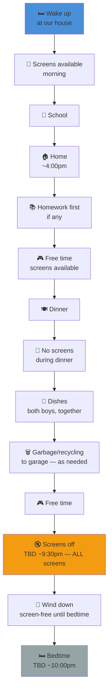
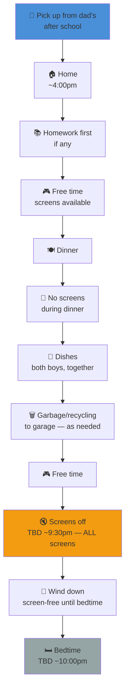

# 01 — Friday

*When boys arrive — evening with Aaron and Denise*
*Note: Every other week they are with us in the morning. The other week they are at their dad's and we pick them up after school. The Friday evening is the same either way.*

## Schedule — Week A (boys wake up at our house)

## Schedule — Week B (we pick them up after school)

## Rules (same both weeks — evening only)

| Rule | Detail |
|------|--------|
| Friday pass down | Level-set conversation when they arrive. How was your week? What's coming up? |
| Garbage/recycling | Bins to garage — done as needed (alternates daily). Part of the floor, not a screen gate. |
| Dishes | After dinner, both boys, together |
| Dinner | No screens during dinner |
| Screens off | TBD ~9:30pm — ALL screens, no exceptions |
| Bedtime | TBD ~10:00pm (same as Saturday) |

> Friday is the arrival day. The morning differs by custody week — Week A they wake up with us, Week B we pick them up after school. The evening is the same either way: the pass down happens first, then the evening schedule applies.
