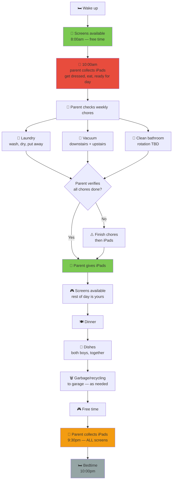
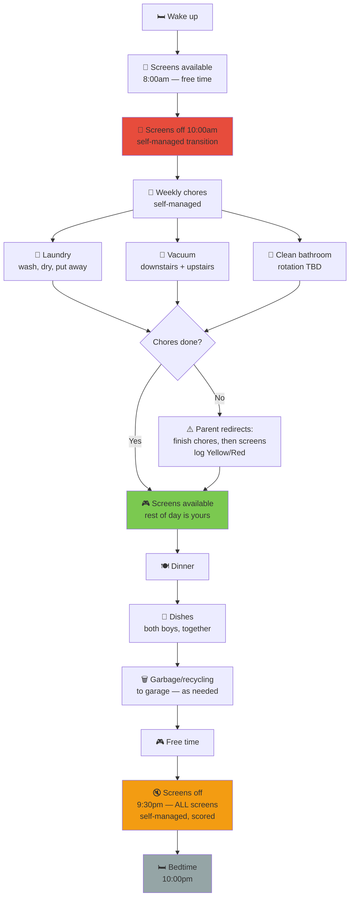

# 02 — Saturday

*Full day — boys with Aaron and Denise*

---

## Two Phases

**Phase 1 — Baseline (Nov 13-20 and Nov 27-Dec 4):** Screens available 8am-10am (free time). At 10am parent collects iPads — floor items done before iPads come back. Parent enforces evening transitions.

**Phase 2 — Trial (Dec 11+):** Boys self-manage 10am transition and weekly chores. Parent steers on failure. Evening transitions self-managed and scored.

---

## Phase 1 — Baseline Schedule

**Phase 1 — what's different:** Screens available 8am-10am (free time). At 10am parent collects iPads — get dressed, eat, ready for the day. They can do chores earlier than 10am if they want, but the expectation is they get moving at 10am sharp. Parent hands over iPads after weekly chores verified, collects them at screens-off time.

---

## Phase 2 — Trial Schedule

**Phase 2 — what's different:** Boys self-manage the 10am transition — no parent enforcement. Boys do weekly chores on their own. If parent finds screens on with chores undone, redirect and log Yellow/Red. Evening transitions self-managed and scored.

---

## Before Screens — Weekly Chores (both phases)

- [ ] Laundry: wash, dry, and start putting away your own clothes
- [ ] Vacuum: downstairs and upstairs
- [ ] Clean bathroom (rotation TBD with Denise)
- [ ] Help with anything else we ask — as needed, as directed, no pushback

## Rules (both phases)

| Rule | Detail |
|------|--------|
| 10:00am | Screens off. Get dressed, eat, ready for the day. |
| Before screens | Weekly chores done first. |
| Garbage/recycling | Done as needed (alternates daily). Part of the floor, not a screen gate. |
| Dishes | After dinner, both boys, together. |
| Screens off | 9:30pm — ALL screens, no exceptions. |
| Bedtime | 10:00pm. |
| Impromptu | When asked to help (decorations, Costco, etc.), help. No pushback. |

## Key Transitions

1. **8am-10am free time → 10am chores.** Screens available 8am-10am. At 10am, screens off and floor items start. Phase 1: parent collects iPads at 10am, checks chores, then hands iPads back. Phase 2: self-managed — this is where autonomy is tested.
2. **~9:30pm screens off.** All screens off. Phase 1: parent collects iPads. Phase 2: self-managed and scored — do they stop when asked?

> Garbage is done as needed after dinner — not a before-screens gate.
