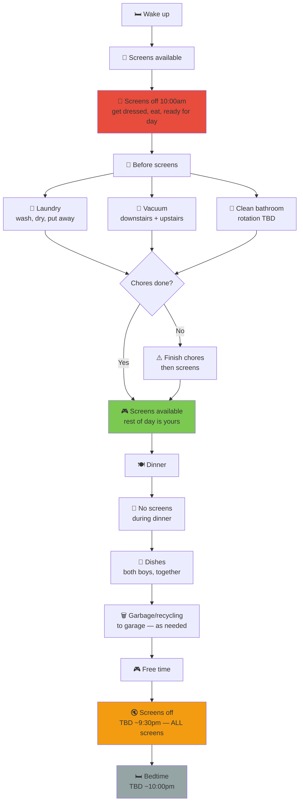

# 02 — Saturday

*Full day — boys with Aaron and Denise*

## Schedule

## Before Screens (weekly chores done first)

- [ ] Laundry: wash, dry, and start putting away your own clothes
- [ ] Vacuum: downstairs and upstairs
- [ ] Clean bathroom (rotation TBD with Denise)

## Rules

| Rule | Detail |
|------|--------|
| 10:00am | Screens off. Get dressed, eat, ready for the day. |
| Before screens | Weekly chores done first. |
| Garbage/recycling | Done as needed (alternates daily). Part of the floor, not a screen gate. |
| Dishes | After dinner, both boys, together. |
| Dinner | No screens during dinner. |
| Screens off | TBD ~9:30pm — ALL screens, no exceptions. |
| Bedtime | TBD ~10:00pm. |
| Impromptu | When asked to help (decorations, Costco, etc.), help. No pushback. |

## Key Transitions

1. **10:00am → chores.** Screens stop, weekly chores start. This is where the floor is tested.
2. **~9:30pm screens off.** All screens off. Screen Transition is scored — do they stop when asked?

> Garbage is done as needed after dinner — not a before-screens gate. 
