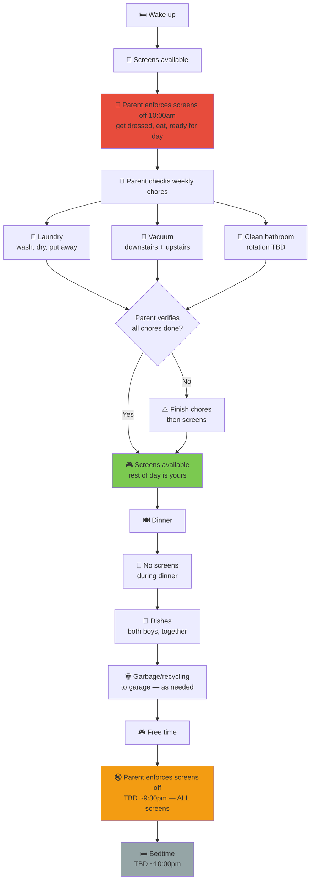
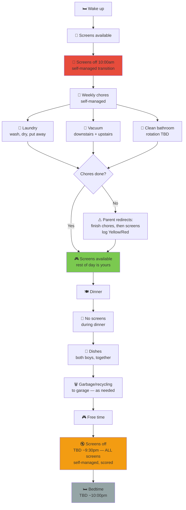

# 02 — Saturday

*Full day — boys with Aaron and Denise*

---

## Two Phases

**Phase 1 — Baseline (Nov 13-20):** Parent enforces 10am transition. Parent checks each weekly chore before screens. Parent enforces evening transitions.

**Phase 2 — Trial (Nov 27+):** Boys self-manage 10am transition and weekly chores. Parent steers on failure. Evening transitions self-managed and scored.

---

## Phase 1 — Baseline Schedule

**Phase 1 — what's different:** Parent enforces the 10am transition. Parent verifies each weekly chore is done before screens open. Parent enforces screens-off and bedtime.

---

## Phase 2 — Trial Schedule

**Phase 2 — what's different:** Boys self-manage the 10am transition — no parent enforcement. Boys do weekly chores on their own. If parent finds screens on with chores undone, redirect and log Yellow/Red. Evening transitions self-managed and scored.

---

## Before Screens — Weekly Chores (both phases)

- [ ] Laundry: wash, dry, and start putting away your own clothes
- [ ] Vacuum: downstairs and upstairs
- [ ] Clean bathroom (rotation TBD with Denise)

## Rules (both phases)

| Rule | Detail |
|------|--------|
| 10:00am | Screens off. Get dressed, eat, ready for the day. |
| Before screens | Weekly chores done first. |
| Garbage/recycling | Done as needed (alternates daily). Part of the floor, not a screen gate. |
| Dishes | After dinner, both boys, together. |
| Dinner | No screens during dinner. |
| Screens off | TBD ~9:30pm — ALL screens, no exceptions. |
| Bedtime | TBD ~10:00pm. |
| Impromptu | When asked to help (decorations, Costco, etc.), help. No pushback. |

## Key Transitions

1. **10:00am → chores.** Screens stop, weekly chores start. Phase 1: parent enforces this. Phase 2: self-managed — this is where autonomy is tested.
2. **~9:30pm screens off.** All screens off. Phase 1: parent enforces. Phase 2: self-managed and scored — do they stop when asked?

> Garbage is done as needed after dinner — not a before-screens gate.
