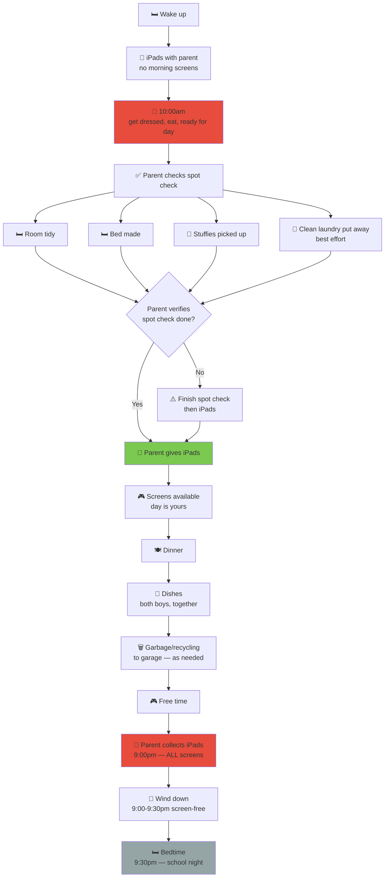
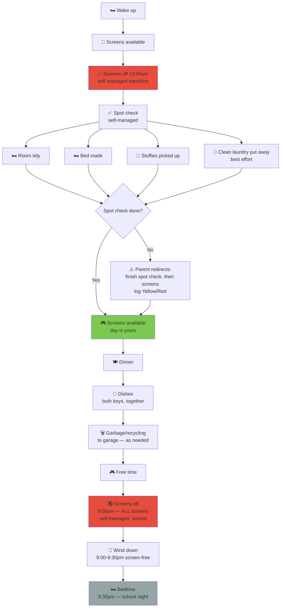

# 03 — Sunday

*Full day — school night evening*

---

## Two Phases

**Phase 1 — Baseline (Nov 13-20 and Nov 27-Dec 4):** iPads physically held by parent from wake-up. No morning screen time. Parent checks spot check before handing over iPads. Parent enforces school-night evening.

**Phase 2 — Trial (Dec 11+):** Boys self-manage 10am transition and spot check. Parent steers on failure. Evening transitions self-managed and scored.

---

## Phase 1 — Baseline Schedule

**Phase 1 — what's different:** iPads held by parent from wake-up — no morning screen time. 10am transition is just getting ready. Parent hands over iPads after spot check verified, collects them at 9pm.

---

## Phase 2 — Trial Schedule

**Phase 2 — what's different:** Boys self-manage the 10am transition and spot check. If parent finds screens on with spot check undone, redirect and log Yellow/Red. 9pm screens-off is self-managed and scored.

---

## Before Screens — Spot Check (both phases)

- [ ] Room tidy
- [ ] Bed made
- [ ] Stuffies picked up
- [ ] Clean laundry put away (best effort — if not fully folded, that's okay, but what's done needs to be put away)

## Rules (both phases)

| Rule | Detail |
|------|--------|
| 10:00am | Screens off. Get dressed, eat, ready for the day. |
| Before screens | Spot check done first. |
| Garbage/recycling | Done as needed (alternates daily). Part of the floor, not a screen gate. |
| Dishes | After dinner, both boys, together. |
| Screens off | 9:00pm — **ALL screens**, no exceptions. |
| Bedtime | 9:30pm — **school night, back to normal** |

> Sunday is lighter than Saturday. No weekly chores — just a spot check to make sure rooms are ready for the school week. Garbage is done as needed. Sunday evening reverts to school-night schedule: screens off at 9:00pm, bedtime 9:30pm. This is the reset point for Monday morning.
