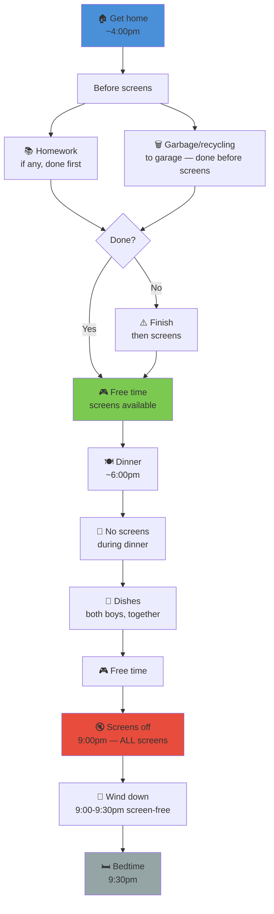

# 04 — School Day

*Monday-Thursday, school in session*

## Schedule

## Before Screens (homework and garbage done first)

- [ ] Homework first. If you have homework, it gets done before screens.
- [ ] Garbage and recycling bins taken out to garage (alternates daily: Sean / Liam)
- [ ] No recreational screens before school.

## Rules

| Rule | Detail |
|------|--------|
| Before screens | Homework first + garbage done. No recreational screens before school. |
| Dishes | After dinner, both boys, together |
| Dinner | No screens during dinner |
| Screens off | 9:00pm — **ALL screens** (gaming, YouTube, TV, reels,, phones,, iPads). No exceptions. |
| Wind down | 9:00-9:30pm screen-free |
| Bedtime | 9:30pm |

## Key Transitions

1. **4:00pm arrival → homework and garbage.** If there's homework, it gets done before screens. Garbage goes out. If no homework, screens are available after garbage. This is where the homework-first rule is tested.
2. **9:00pm screens off.** All screens off. The wind-down to bedtime is screen-free. This is where Screen Transition is scored — do they stop when asked, or push back?

> School days are Monday-Thursday. Friday is its own day (see 01-Friday).
