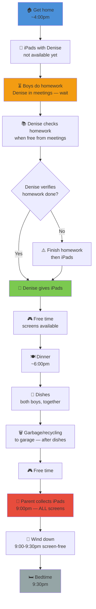
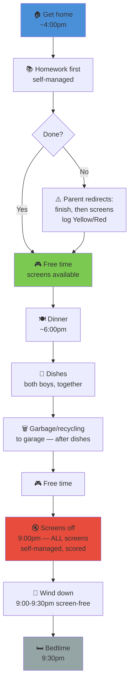

# 04 — School Day

*Monday-Thursday, school in session*

---

## Two Phases

**Phase 1 — Baseline (Nov 13-20 and Nov 27-Dec 4):** iPads physically held by parent until homework verified. Parent checks when available — boys may wait while Denise finishes meetings. No autonomy yet.

**Phase 2 — Trial (Dec 11+):** Boys self-manage homework before screens. Parent steers on failure. Evening transitions self-managed and scored.

---

## Phase 1 — Baseline Schedule

**Phase 1 — what's different:** iPads held by Denise — not available until homework is verified. Boys come home at ~4pm but Denise may be in meetings. They do homework (or wait) until she's free, then she checks and hands over iPads. Parent collects iPads at 9pm screens-off. If boys interrupt Denise's meetings to nag for iPads, that's pushback — Yellow on the tracker.

---

## Phase 2 — Trial Schedule

**Phase 2 — what's different:** Boys self-manage homework before screens — no parent pre-check. If parent finds screens on with homework undone, redirect and log Yellow/Red. 9pm screens-off is self-managed and scored — do they stop when asked, or push back?

---

## Before Screens (both phases)

- [ ] Homework first. If you have homework, it gets done before screens.
- [ ] No recreational screens before school.

## Rules (both phases)

| Rule | Detail |
|------|--------|
| Before screens | Homework first. No recreational screens before school. |
| Dishes | After dinner, both boys, together |
| Garbage/recycling | Done right after dishes (alternates daily). Part of the floor, not a screen gate. |
| Screens off | 9:00pm — **ALL screens** (gaming, YouTube, TV, reels, phones, iPads). No exceptions. |
| Wind down | 9:00-9:30pm screen-free |
| Bedtime | 9:30pm |

## Key Transitions

1. **4:00pm arrival → wait → homework check.** Boys come home, iPads are with Denise. If Denise is in meetings, boys wait and do homework. When Denise is free, she checks homework and hands over iPads. Phase 2: self-managed — no wait, no parent check.
2. **9:00pm screens off.** All screens off. The wind-down to bedtime is screen-free. Phase 1: parent collects iPads. Phase 2: self-managed and scored — do they stop when asked, or push back?

---

> **Note for Denise:** During Phase 1, the iPad hand-off happens when you're available — not at 4pm sharp. If you're in a meeting when the boys get home, they wait. The iPads are with you, so there's nothing to negotiate. If they interrupt your meeting to ask for iPads, that's pushback — log it as a Yellow. The wait time is baseline data: it tells us whether they can self-regulate their impulses, which is exactly what we're assessing. After two weeks, the iPads are theirs to manage.

> Garbage is done right after dishes — not a before-screens gate. School days are Monday-Thursday. Friday is its own day (see 01-Friday).
