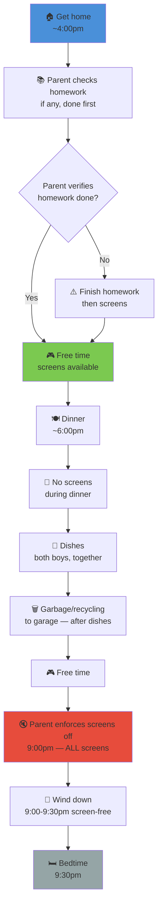
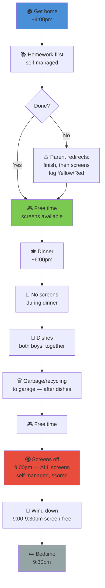

# 04 — School Day

*Monday-Thursday, school in session*

---

## Two Phases

**Phase 1 — Baseline (Nov 13-20):** Parent checks homework before screens. Parent enforces all transitions. No autonomy yet.

**Phase 2 — Trial (Nov 27+):** Boys self-manage homework before screens. Parent steers on failure. Evening transitions self-managed and scored.

---

## Phase 1 — Baseline Schedule

**Phase 1 — what's different:** Parent checks homework before screens open. Parent enforces 9pm screens-off and bedtime transitions.

---

## Phase 2 — Trial Schedule

**Phase 2 — what's different:** Boys self-manage homework before screens — no parent pre-check. If parent finds screens on with homework undone, redirect and log Yellow/Red. 9pm screens-off is self-managed and scored — do they stop when asked, or push back?

---

## Before Screens (both phases)

- [ ] Homework first. If you have homework, it gets done before screens.
- [ ] No recreational screens before school.

## Rules (both phases)

| Rule | Detail |
|------|--------|
| Before screens | Homework first. No recreational screens before school. |
| Dishes | After dinner, both boys, together |
| Garbage/recycling | Done right after dishes (alternates daily). Part of the floor, not a screen gate. |
| Dinner | No screens during dinner |
| Screens off | 9:00pm — **ALL screens** (gaming, YouTube, TV, reels, phones, iPads). No exceptions. |
| Wind down | 9:00-9:30pm screen-free |
| Bedtime | 9:30pm |

## Key Transitions

1. **4:00pm arrival → homework.** If there's homework, it gets done before screens. If no homework, screens are available. Phase 1: parent checks. Phase 2: self-managed — this is where the homework-first rule is tested.
2. **9:00pm screens off.** All screens off. The wind-down to bedtime is screen-free. Phase 1: parent enforces. Phase 2: self-managed and scored — do they stop when asked, or push back?

> Garbage is done right after dishes — not a before-screens gate. School days are Monday-Thursday. Friday is its own day (see 01-Friday).
