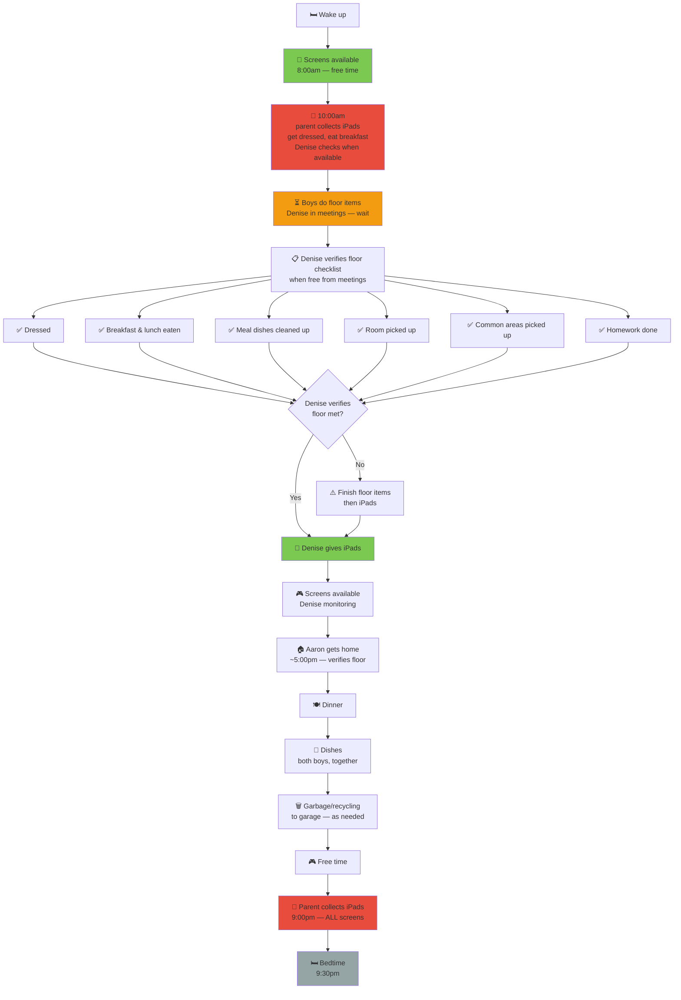
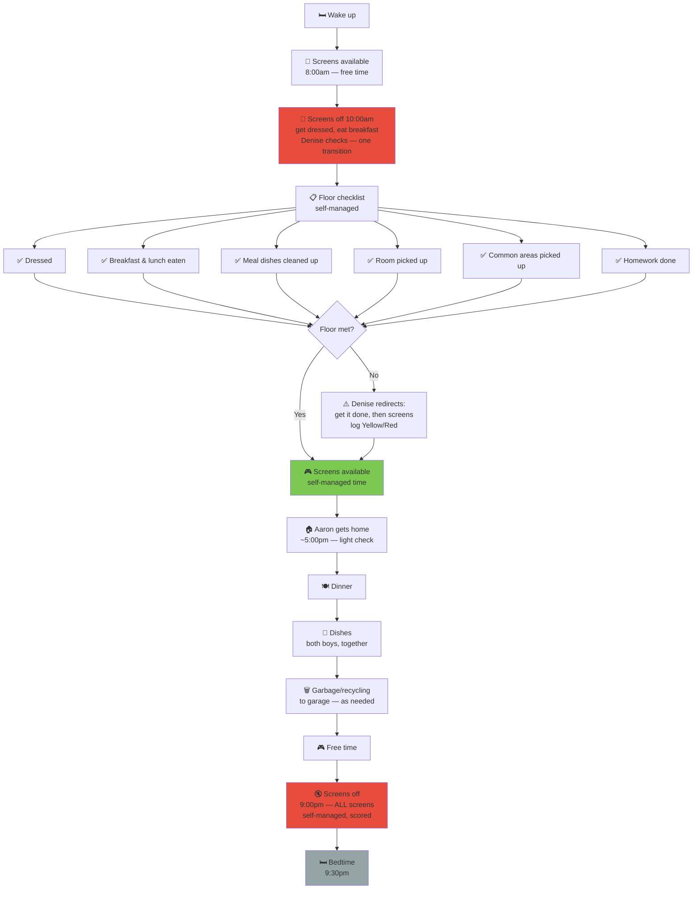

# 05 — Weekday Off

*No school — Denise working from home, Aaron at work*

---

## Two Phases

**Phase 1 — Baseline (Nov 13-20 and Nov 27-Dec 4):** Screens available 8am-10am (free time). At 10am parent collects iPads — floor checklist done before iPads come back. Denise verifies when available. No autonomy.

**Phase 2 — Trial (Dec 11+):** Denise still checks the 10am transition (she's home). After 10am, boys self-manage the floor checklist. Aaron does a light end-of-day check. Parent steers on failure.

---

## Phase 1 — Baseline Schedule

**Phase 1 — what's different:** Screens available 8am-10am (free time). At 10am parent collects iPads — get dressed, eat, ready for the day. They can do floor checklist items earlier than 10am if they want, but the expectation is they get moving at 10am sharp. Boys do floor items while Denise works. When Denise is free from meetings, she verifies the floor checklist and hands over iPads. Aaron collects iPads at screens-off time. If boys interrupt Denise's meetings to nag for iPads, that's pushback — Yellow on the tracker.

---

## Phase 2 — Trial Schedule

**Phase 2 — what's different:** Denise still checks the 10am get-dressed transition (she's home, this is the one parent-checked transition). After 10am, boys self-manage the floor checklist — no Denise pre-check. If Denise notices floor unmet while they're on screens, redirect and log Yellow/Red. Aaron does a light end-of-day check when he gets home — redirects only if issues noticed, no full pre-check. Evening transitions self-managed and scored.

---

## 10:00am Transition (both phases — Denise checks this one)

- Screens off. Get dressed, eat breakfast. (Denise checks — this is the one transition during the day.)

## Before Screens — Floor Checklist (both phases)

- [ ] Dressed
- [ ] Breakfast and lunch eaten
- [ ] Your meal dishes cleaned up (rinsed, in dishwasher)
- [ ] Room picked up (not wrecked)
- [ ] Common areas picked up (no stuff left all over the house)
- [ ] Any homework done (homework-first rule still applies — see [What Counts as Homework](../floor-expectations.md#what-counts-as-homework))

## Rules (both phases)

| Rule | Detail |
|------|--------|
| 10:00am | Screens off. Get dressed, eat breakfast. Denise checks. |
| Before screens | Floor checklist done. |
| After floor met | Screens available. Self-managed time (Phase 2). |
| Dishes | After dinner, both boys, together |
| Garbage/recycling | Done as needed (alternates daily). Part of the floor, not a screen gate. |
| Screens off | 9:00pm — **ALL screens**, no exceptions. |
| Bedtime | 9:30pm |

## How It Works

The boys manage their own time between 10am and evening. Screens are available — that's the autonomy piece. The floor is what needs to be true before screens resume after the 10am get-dressed transition. How they get there is their call. Garbage is done as needed — part of the floor, not a screen gate. Sometimes grandparents may take them for the day.

If the floor isn't met, it's a redirect (not punishment) — get it done, then screens are back. If the pattern repeats (3+ Reds in a week), structural rollback to Phase 1.

---

> **Note for Denise:** During Phase 1, the iPad hand-off happens when you're available — not at 10am sharp. If you're in a meeting at 10am or after, the boys do their floor items (get dressed, eat, clean up) and wait. The iPads are with you, so there's nothing to negotiate. If they interrupt your meeting to ask for iPads, that's pushback — log it as a Yellow. The wait time is baseline data: it tells us whether they can self-regulate, which is exactly what we're assessing. After two weeks, the iPads are theirs to manage.
