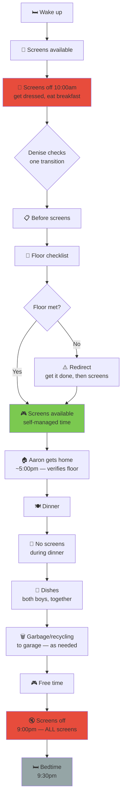

# 05 — Weekday Off

*No school — Denise working from home, Aaron at work*

## Schedule

## Before Screens (floor checklist done first)

- [ ] Dressed
- [ ] Breakfast and lunch eaten
- [ ] Meal dishes cleaned up (rinsed, in dishwasher)
- [ ] Room picked up (not wrecked)
- [ ] Common areas picked up (no stuff left all over the house)
- [ ] Any homework done (homework-first rule still applies)

## Rules

| Rule | Detail |
|------|--------|
| 10:00am | Screens off. Get dressed, eat breakfast. Denise checks. |
| Before screens | Floor checklist done. |
| After floor met | Screens available. Self-managed time. |
| Dishes | After dinner, both boys, together |
| Garbage/recycling | Done as needed (alternates daily). Part of the floor, not a screen gate. |
| Dinner | No screens during dinner |
| Screens off | 9:00pm — **ALL screens**, no exceptions. |
| Bedtime | 9:30pm |

## How It Works

The boys manage their own time between 10am and evening. Screens are available — that's the autonomy piece. The floor is what needs to be true before screens resume after the 10am get-dressed transition. How they get there is their call. Garbage is done as needed — part of the floor, not a screen gate. Sometimes grandparents may take them for the day.

If the floor isn't met, it's a redirect (not punishment) — get it done, then screens are back. If the pattern repeats (3+ Reds in a week),, structural rollback.
