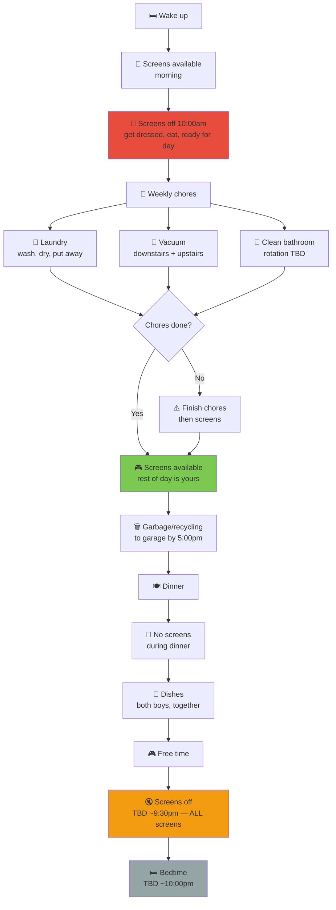

# Saturday

*Full day — boys with Aaron and Denise*

## Schedule

## Weekly Chores (before screens resume)

- [ ] Laundry: wash, dry, and start putting away your own clothes
- [ ] Vacuum: downstairs and upstairs
- [ ] Clean bathroom (rotation TBD with Denise)

## Rules

| Rule | Detail |
|------|--------|
| 10:00am | Screens off. Get dressed, eat, ready for the day. |
| Before screens | Weekly chores done first (laundry, vacuum, bathroom). |
| Garbage/recycling | Bins to garage by 5:00pm (alternates daily). |
| Dishes | After dinner, both boys, together. |
| Dinner | No screens during dinner. |
| Screens off | TBD ~9:30pm — ALL screens, no exceptions. |
| Bedtime | TBD ~10:00pm. |
| Impromptu | When asked to help (decorations, Costco, etc.), help. No pushback. |

## Key Transition

The **10:00am → chores** transition is the critical one. Screens stop, weekly chores start. This is where the floor is tested — do they do the chores without pushback (Green),, need a reminder (Yellow),, or refuse (Red)?

Once chores are done, screens are open for the rest of the day. The next tracked transition is 9:00pm screens off.
