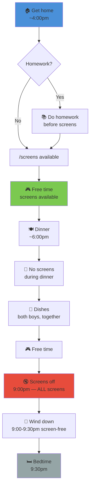

# School Day

*Monday-Friday, school in session*

## Schedule

## Rules

| Rule | Detail |
|------|--------|
| Before screens | Homework first. No recreational screens before school. |
| Garbage/recycling | Bins to garage by 5:00pm (alternates daily: Sean / Liam) |
| Dishes | After dinner, both boys, together |
| Dinner | No screens during dinner |
| Screens off | 9:00pm — ALL screens (gaming, YouTube, TV, reels,, phones,, iPads). No exceptions. |
| Wind down | 9:00-9:30pm screen-free |
| Bedtime | 9:30pm |

## Key Transitions

The two transition points tracked on the Sheet:

1. **4:00pm arrival → homework or free time.** If there's homework, it gets done before screens. If not, screens are available. This is where the homework-first rule is tested.
2. **9:00pm screens off.** All screens off. The wind-down to bedtime is screen-free. This is where Screen Transition is scored — do they stop when asked, or push back?
