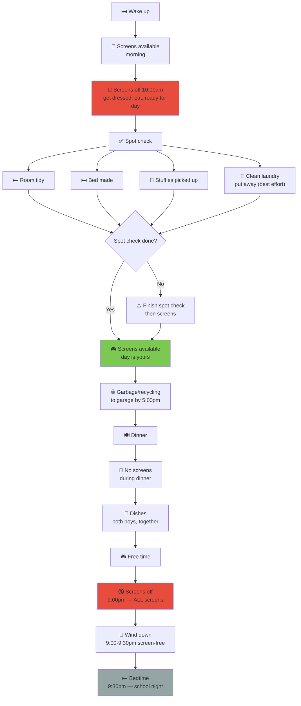

# Sunday

*Full day — school night evening*

## Schedule

## Spot Check (before screens resume)

- [ ] Room tidy
- [ ] Bed made
- [ ] Stuffies picked up
- [ ] Clean laundry put away (best effort — if not fully folded, that's okay, but what's done needs to be put away)

## Rules

| Rule | Detail |
|------|--------|
| 10:00am | Screens off. Get dressed, eat, ready for the day. |
| Before screens | Spot check done first. |
| Garbage/recycling | Bins to garage by 5:00pm (alternates daily). |
| Dishes | After dinner, both boys, together. |
| Dinner | No screens during dinner. |
| Screens off | 9:00pm — ALL screens, no exceptions. |
| Bedtime | 9:30pm — **school night, back to normal** |

## Key Difference from Saturday

Sunday is lighter than Saturday. No weekly chores — just a spot check to make sure rooms are ready for the school week. The spot check is about: room tidy, bed made, stuffies picked up, laundry put away. Best effort on the laundry — if it's not all folded, that's okay.

Sunday evening reverts to school-night schedule: screens off at9:00pm, bedtime 9:30pm. This is the reset point for Monday morning.
