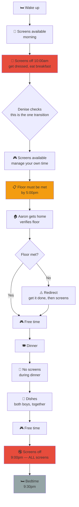

# Weekday Off

*No school — Denise working from home, Aaron at work*

## Schedule

## Floor Checklist (by 5:00pm)

- [ ] Dressed
- [ ] Breakfast and lunch eaten
- [ ] Meal dishes cleaned up (rinsed, in dishwasher)
- [ ] Room picked up (not wrecked)
- [ ] Common areas picked up (no stuff left all over the house)
- [ ] Garbage and recycling bins taken out to garage (alternates daily)
- [ ] Any homework done (homework-first rule still applies)

## Rules

| Rule | Detail |
|------|--------|
| 10:00am | Screens off. Get dressed, eat breakfast. Denise checks. |
| 10am-5pm | Screens available. Self-managed time. |
| 5:00pm | Floor must be met when Aaron gets home. |
| Dinner | No screens during dinner |
| Dishes | After dinner, both boys, together |
| Screens off | 9:00pm — ALL screens, no exceptions |
| Bedtime | 9:30pm |

## How It Works

The boys manage their own time between 10am and 5pm. Screens are available — that's the autonomy piece. The floor is what needs to be true by the time Aaron walks in the door. How they get there is their call.

If the floor isn't met, it's a redirect (not punishment) — get it done, then screens are back. If the pattern repeats (3+ Reds in a week),, structural rollback.
