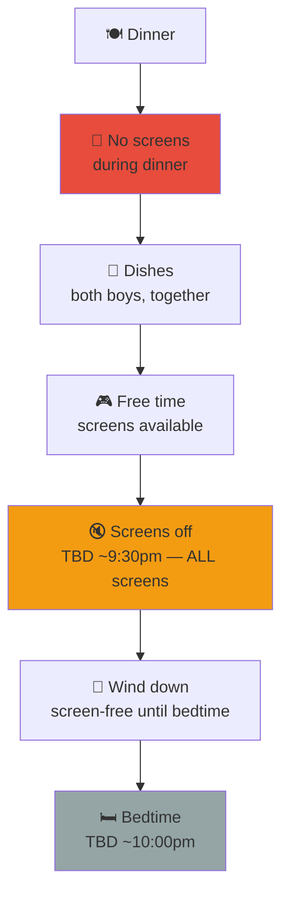

# Weekend Evenings — Friday & Saturday

*When boys are with Aaron and Denise — same rules both nights*

## Schedule

## Rules

| Rule | Detail |
|------|--------|
| Dinner | No screens during dinner. |
| Dishes | After dinner, both boys, together. |
| Screens off | TBD ~9:30pm — ALL screens (gaming, YouTube, TV, reels,, phones,, iPads). No exceptions. |
| Wind down | Screen-free until bedtime. |
| Bedtime | TBD ~10:00pm. |

## Open Item: Bedtime

Aaron proposing +30 min max (10:00pm). Denise wants later. Proposed approach: try +30 and review Monday morning tracker data. If consistently Yellow/Red on Monday mornings, adjust back.

Both Friday and Saturday evenings have the **same bedtime and screen-off time**. Sunday evening reverts to school night (9:00pm / 9:30pm).

## What's Different from School Nights

| | School night | Weekend evening |
|---|---|---|
| Screens off | 9:00pm | TBD ~9:30pm |
| Bedtime | 9:30pm | TBD ~10:00pm |
| Free time after dinner | Yes | Yes |
| Wind-down buffer | 9:00-9:30pm | Screen-free until bedtime |

The extra 30 minutes is the only difference. Everything else — dinner, dishes, no screens during dinner, free time after — stays the same.
